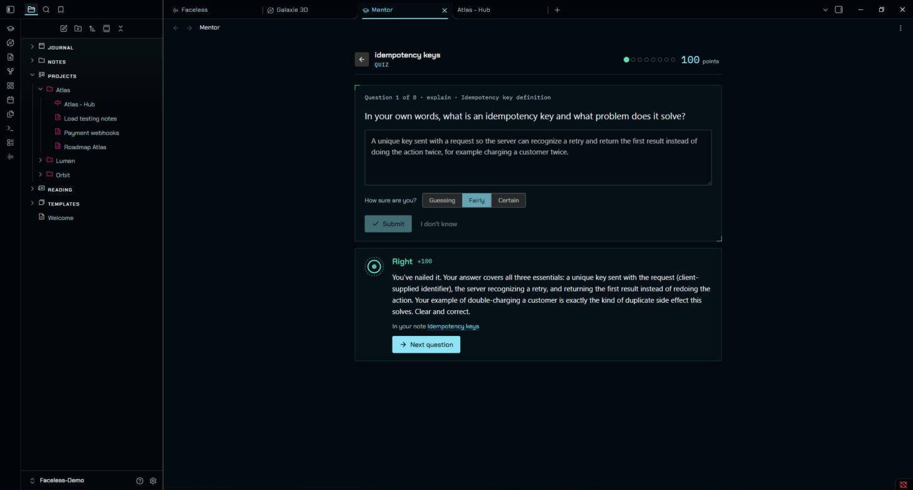

# Mentor

A personal tutor for your Obsidian vault. Mentor reads the notes you choose and turns them into a guided lesson, a quiz, a timed challenge and spaced-repetition cards, using the study methods that research ranks as the most effective.



## What it does

- **Guided lesson.** Mentor builds a lesson plan from your notes, then takes you through one concept at a time: a question before the explanation, a worked example when you need it, and a check question you answer in your own words. It moves on only once you got it right on your own. A hint, an example or another explanation is always one click away.
- **Quiz.** Mostly written-answer questions, graded on meaning rather than wording, with your confidence level for each answer. Mistakes made while feeling sure are flagged, since they are the ones you correct best. "Explain it to me" gives a deeper explanation after any answer.
- **Timed challenge.** Fast multiple-choice questions, 20 seconds each, with more points for quick right answers.
- **Spaced review.** Missed questions and the key points of each lesson become cards, scheduled with FSRS (the algorithm used by Anki) and mixed across topics.
- **Lesson summary.** At the end of a lesson, Mentor can save a Markdown summary with links to your source notes.

Start from the Mentor icon in the ribbon, the command palette, or right-click a note or a folder. You can also type a question: Mentor finds the matching notes in your vault.

The interface is in English and French (it follows Obsidian's language, or choose it in the settings).

## Requirements

Mentor does not contain an AI model. It runs **Claude Code**, Anthropic's command-line tool, already installed on your computer.

1. Install Claude Code: see [Anthropic's setup guide](https://code.claude.com/docs/en/setup).
2. Open a terminal, run `claude` once and sign in.
3. In Obsidian, open Mentor's settings and click **Detect**, then **Test**.

Desktop only (Windows, macOS, Linux).

## Disclosures

- **Account and payment.** Claude Code needs your own Anthropic account: a paid Claude plan (Pro, Max, Team…) or a Claude Console account billed by usage. Mentor's usage is billed to that account under your own agreement with Anthropic. Mentor never sees, stores or asks for your credentials; sign-in happens in Claude Code itself.
- **Network use.** To build a lesson or a quiz, Mentor sends the text of the notes you selected (up to the size set in the settings) and your answers to Claude Code, which sends them to Anthropic's servers. Nothing is sent until you start a lesson, a quiz, a challenge or a test. Mentor itself has no server and no telemetry.
- **Files outside the vault.** Mentor runs the `claude` program installed on your computer: it looks for it in its usual install folders and on your system path, or uses the path you enter. For each request it writes a temporary instruction file in your system's temporary folder (`obsidian-mentor`) and deletes it right after. Claude Code runs there with no tools, so it cannot read or change your files.
- Your progress (topics, cards, review history) is stored in the plugin's `data.json` in your vault.

Mentor is an independent project. It is not made, endorsed or supported by Anthropic.

## Settings

- **Language**: automatic, English or French.
- **Claude Code path** and **Model** (Sonnet by default, Opus for more depth).
- **About you**: your level and goals, so examples and difficulty fit you.
- **Go beyond the notes**: let Mentor complete incomplete notes with general knowledge, always flagged.
- Questions per quiz, new cards per day, target retention, amount of notes sent, ignored folders and the folder for lesson summaries.

## The learning science behind it

- Testing yourself (retrieval practice) and spacing reviews are the two most useful study techniques (Dunlosky et al. 2013).
- Questions asked before a lesson improve learning (St. Hilaire et al. 2023).
- Worked examples help beginners, then guidance fades as you progress (Sweller; Kalyuga).
- Explaining in your own words is a generative activity that deepens understanding (Fiorella & Mayer 2016).
- High-confidence errors, once corrected, are the best remembered: the hypercorrection effect (Butterfield & Metcalfe 2001).
- A concept counts as learned after one correct recall without help (Rawson & Dunlosky, successive relearning).
- AI tutors work when they guide step by step and the learner does the thinking (Kestin et al. 2025; Bastani et al. 2025).

## Build from source

```
npm install
node build.mjs
```

Copy `dist/main.js`, `manifest.json` and `styles.css` into `.obsidian/plugins/mentor/` in your vault, then enable Mentor in **Settings → Community plugins**.

## License

MIT

---

## En français

Mentor est un tuteur personnel pour ton vault Obsidian. Il lit les notes que tu choisis et en fait une leçon guidée, un quiz, un défi chrono et des fiches de révision espacée (FSRS), avec les méthodes d'apprentissage que la recherche juge les plus efficaces. L'interface est en français et en anglais.

Mentor ne contient pas de modèle d'IA : il lance **Claude Code**, l'outil en ligne de commande d'Anthropic, installé sur ton ordinateur et connecté à ton propre compte (abonnement Claude payant ou clé API). L'usage est facturé sur ce compte. Pour préparer une leçon ou un quiz, le texte des notes choisies et tes réponses passent par Claude Code jusqu'aux serveurs d'Anthropic ; rien n'est envoyé avant que tu lances une séance. Mentor n'a ni serveur ni télémétrie. Mentor est un projet indépendant, ni conçu ni soutenu par Anthropic.
